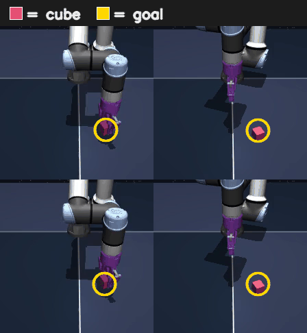
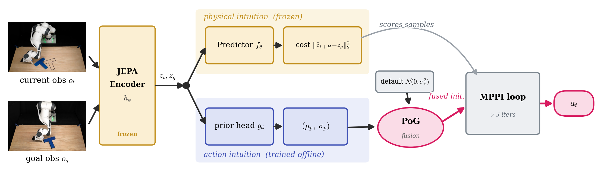

# PRISM-JEPA
### PRior-guided Imagination Sampling in world Models — JEPA edition

PRISM injects a learned **action prior** into a sampling-based MPC planner via
closed-form **Product-of-Gaussians fusion** at the planner's initial sampling
distribution. On a JEPA world model, this turns a 1-line architectural change
into large success-rate gains on goal-conditioned visual manipulation tasks
without changing the planner, the cost, or introducing new hyperparameters.

<p align="center">
  
  &nbsp;&nbsp;&nbsp;&nbsp;
  
  <br>
  <sub><em>PRISM-MPPI rollouts (s = 1, K = 128):
  OGBench <code>cube-single</code> (left) and PushT (right).</em></sub>
</p>

<p align="center">
  <b>[ <a href="#">Paper</a> (TBA) | <a href="https://huggingface.co/YuhaiW/prism-jepa-cube">Cube weights</a> | <a href="https://huggingface.co/YuhaiW/prism-jepa-pusht">PushT weights</a> ]</b>
</p>

---

## Headline results

Mean ± std success-rate over 3 seeds {0, 1, 42}, planner budget **K = 128**:

|              | Vanilla MPPI | BC-only | **PRISM-MPPI (s = 1)** |
|:------------:|:------------:|:-------:|:----------------------:|
| **Cube**     |     44.0     |   66.0  |     **79.3 ± 6.1**     |
| **PushT**    |     57.0     |   31.0  |     **88.7 ± 4.2**     |

`s = 1` is the only hyperparameter; the full `s`-sweep is in the paper Sec. 4.4.

---

## Pretrained models (HuggingFace)

The exact weights used to produce the headline PRISM-MPPI numbers above are
released on HuggingFace as public model repos. Each bundle contains the JEPA
world model (`lewm_object.ckpt`, ~72 MB) and the matching PRISM prior head
(`prior_head_<task>.pt`, ~2 MB).

| Task  | Repo |
|-------|------|
| Cube  | [`YuhaiW/prism-jepa-cube`](https://huggingface.co/YuhaiW/prism-jepa-cube) |
| PushT | [`YuhaiW/prism-jepa-pusht`](https://huggingface.co/YuhaiW/prism-jepa-pusht) |

See the [Quickstart](#quickstart) section below for the exact `hf download`
commands and the eval invocation that reproduces the paper numbers.

---

## Quickstart

```bash
# 0. clone
git clone git@github.com:YuhaiW/prism-jepa.git
cd prism-jepa

# 1. set up env (uv recommended; ~5 min)
uv venv --python=3.10
source .venv/bin/activate
uv pip install stable-worldmodel[train]
uv pip install opencv-python pygame mujoco pymunk scikit-image hdf5plugin
export STABLEWM_HOME=$HOME/.stable-wm  # picks up weights + datasets here

# 2. download pretrained weights (Cube example; PushT identical with --repo …-pusht)
hf download YuhaiW/prism-jepa-cube --local-dir ./hf_cube
mkdir -p $STABLEWM_HOME/cube
mv hf_cube/lewm_object.ckpt $STABLEWM_HOME/cube/
mv hf_cube/prior_head_cube.pt .

# 3. run PRISM-MPPI (~3 min, 50 episodes, batch K=128 on a single GPU)
python eval_prism_head.py --config-name=cube policy=cube/lewm solver=mppi \
    +head.injection_mode=pog +head.sigma_scale=1.0 \
    +head.ckpt=prior_head_cube.pt eval.num_eval=50
```

You also need the LeWM datasets (used for dataset-stats / scalers at eval time;
not the demonstrations themselves) — see
[`quentinll/lewm`](https://huggingface.co/collections/quentinll/lewm) for the
upstream collection. Drop the extracted `.h5` files under `$STABLEWM_HOME/`.

---

## How it works

<p align="center">
  
</p>

A JEPA world model (frozen encoder `h_ψ` + AR predictor `f_θ`) scores
H-step rollouts in latent space; an MPPI planner samples action sequences from
`N(0, σ_π²)`, scores them with `‖ẑ_{t+H} − z_g‖²`, and reweights elites.
PRISM trains a lightweight **prior head** `g_φ(z_t, z_g) → (μ_p, σ_p)` on
offline demonstrations (β-NLL, β = 0.5) and fuses it with the planner's
default sampling distribution at the initial step via the closed-form
Product-of-Gaussians:

```
μ_init  =  σ_init² · (μ_p / (s·σ_p)²)              σ_init² = ((s·σ_p)⁻² + σ_π⁻²)⁻¹
```

The planner's `σ` stays **frozen** across MPPI iterations (no refit, unlike
CEM); the prior only re-shapes where samples are drawn from, never how the
cost is computed. This keeps PRISM strictly visual-cost-driven (no reward, no
Q-shortcut) while giving the planner a strong starting bet.

---

## Repository layout

```
prism-jepa/
├── prism_mppi.py            ★ ours — PoG-fusion MPPI subclass
├── prism_cem.py             ★ ours — PoG-fusion CEM subclass (ablation)
├── prism_head_policy.py     ★ ours — wraps PriorHead as a swm Policy
├── oracle_policy.py         ★ ours — KNN-oracle reference policy (debug)
├── eval_prism_head.py       ★ ours — main eval entry for PRISM-MPPI
├── eval_oracle.py           ★ ours — oracle eval entry (debug)
├── train_prior_head.py      ★ ours — prior-head trainer (β-NLL)
├── jepa.py / module.py      ▴ vendored from LeWM (patched: see git diff vs upstream)
├── train.py / eval.py       ▴ vendored from LeWM (entry points)
├── jepa_cache.py            ▴ vendored from LeWM (PRISM-aware caching extensions)
├── config/                  ▴ Hydra configs (LeWM tasks + +head namespace)
├── docs/                    ★ method notes, experiments, figures
└── franka/                  (real-robot integration; out-of-scope for sim release)
```

★ = our contribution, ▴ = vendored LeWM (upstream code we depend on / lightly
patched; see [le-wm](https://github.com/lucas-maes/le-wm) for the canonical
versions).

---

## Reproduce the paper

Both tasks use the same recipe — change `cube` ↔ `pusht` and the head ckpt:

```bash
# Cube — PRISM-MPPI (paper main result)
python eval_prism_head.py --config-name=cube policy=cube/lewm solver=mppi \
    +head.injection_mode=pog +head.sigma_scale=1.0 \
    +head.ckpt=prior_head_cube.pt eval.num_eval=50 seed=0
# repeat with seed=1, seed=42 → mean over the three is reported

# Cube — Vanilla MPPI baseline
python eval_prism_head.py --config-name=cube policy=cube/lewm solver=mppi \
    +head.injection_mode=none eval.num_eval=50 seed=0

# PushT — PRISM-MPPI
python eval_prism_head.py --config-name=pusht policy=pusht/lewm solver=mppi \
    +head.injection_mode=pog +head.sigma_scale=1.0 \
    +head.ckpt=prior_head_pusht.pt eval.num_eval=50 seed=0
```

Per-seed numbers you should land within ~ ± std:

| Task  | seed 0 | seed 1 | seed 42 | mean |
|-------|-------:|-------:|--------:|-----:|
| Cube (PRISM-MPPI, s=1) | ≈ 80 | ≈ 86 | ≈ 72 | **79.3** |
| Cube (Vanilla MPPI)    | ≈ 44 | ≈ 48 | ≈ 40 | **44.0** |
| PushT (PRISM-MPPI, s=1) | ≈ 88 | ≈ 92 | ≈ 86 | **88.7** |
| PushT (Vanilla MPPI)    | ≈ 56 | ≈ 60 | ≈ 54 | **57.0** |

The `s`-sweep (`+head.sigma_scale={0.1, 0.3, 1, 2, 3, 10, 30, 100, 1e4}`)
reproduces Fig. 5 of the paper.

---

## Train your own prior head

Trains in ~ 30 min on a single GPU per task. Encoder is frozen; only the
3-layer MLP head learns:

```bash
python train_prior_head.py task=cube  epochs=50 batch_size=512
python train_prior_head.py task=pusht epochs=50 batch_size=512
```

Outputs `prior_head_<task>.pt` at the repo root. The trainer uses **β-NLL
(β = 0.5)** and clamps `σ ≥ 0.05` (the `sigma_floor`) — these were swept in
Sec. 4.4 of the paper.

The LeWM JEPA itself trains from scratch via `python train.py data=<task>`;
see [`README_LEWM_UPSTREAM.md`](README_LEWM_UPSTREAM.md) for the upstream
recipe.

---

## Citation

_BibTeX to be added._

## Acknowledgements

Built on top of [LeWM (LeWorldModel)](https://github.com/lucas-maes/le-wm) by
Lucas Maes, Quentin Le Lidec, Damien Scieur, Yann LeCun, and Randall
Balestriero. We thank them for an excellent, hackable JEPA codebase.

## License

MIT — see [`LICENSE`](LICENSE). Vendored LeWM files retain their upstream
MIT copyright; the LICENSE file carries both.
