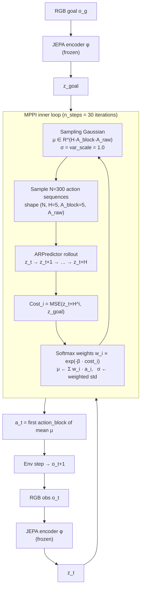
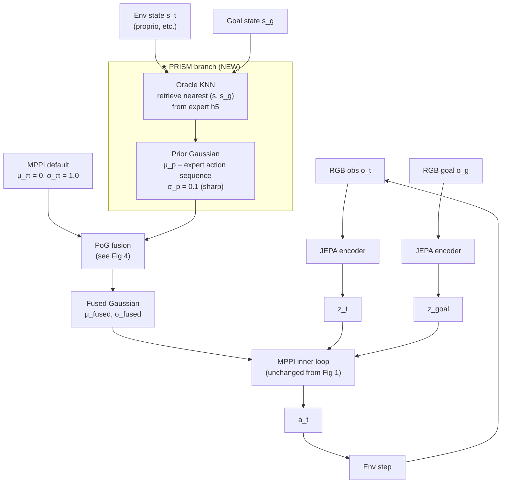
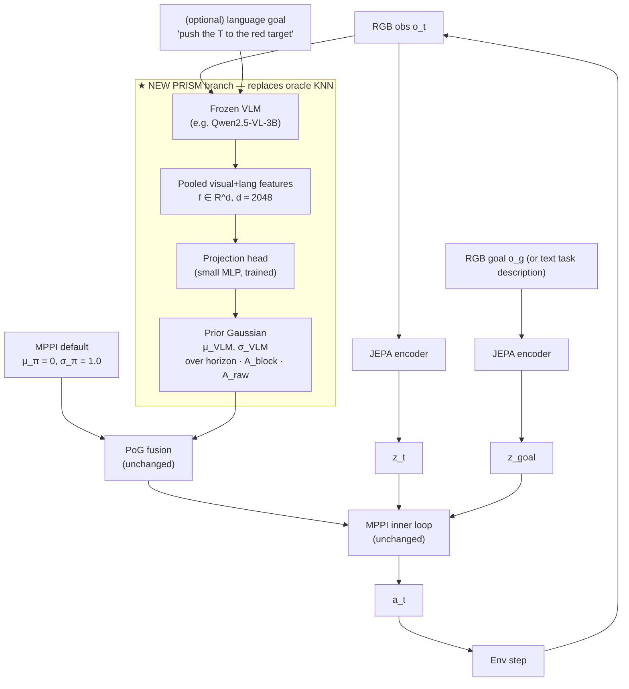

# 08. Architecture Diagrams — LeWM Baseline vs PRISM-MPPI

Five figures, in order of dependency:

1. Original LeWM eval pipeline (no PRISM)
2. Zoom on the MPPI sampling distribution — the object PRISM modifies
3. Where PRISM injects (oracle version, current state of the project)
4. PoG fusion math, in pictures
5. Phase 3: VLM-PRISM (replaces the oracle, same fusion)

Mermaid blocks render in GitHub, VS Code, and most markdown previewers.
If you need real slides later, copy each block into draw.io, Excalidraw,
or Keynote — the structure is small enough to redraw.

---

## 8.1 Figure 1 — Original LeWM eval pipeline (baseline MPPI)



**Read this figure as:** at each env step, the planner runs a 30-iteration
inner loop that refines a Gaussian over *action sequences* (not single
actions). The world model is purely visual — embedding-MSE-to-goal is the
only cost signal. There is no Q-network, no reward head, no learned value
function.

This matters because **every bit of "I want to reach the goal" knowledge
has to come through the cost**, and the cost only sees the *predicted*
final embedding. If the initial sampling Gaussian is centered on bad
actions, MPPI must discover good ones from scratch via sample reweighting.
That's where PRISM helps — it gives the sampler a head start.

---

## 8.2 Figure 2 — The MPPI sampling distribution (PRISM's only target)

```
                    Action-sequence space
                  (dim = H · A_block · A_raw)
                       e.g. 5 · 5 · 2 = 50 for PushT

       ╭────────────────────────────────────────╮
       │                                        │
       │              ╱─────╲                   │
       │            ╱         ╲                 │
       │          │   N(0, I)  │  ← MPPI default│
       │            ╲         ╱                 │
       │              ╲─────╱                   │
       │                                        │
       ╰────────────────────────────────────────╯

   Default:   μ_π = 0,   σ_π = var_scale = 1.0
   What MPPI does:   draws N=300 samples,
                     reweights, refits μ_π and σ_π,
                     repeats 30×.
```

PRISM does **not** touch the encoder, the predictor, the cost, or the
reweighting rule. PRISM's *entire* contribution is to replace
`μ_π = 0, σ_π = var_scale` at iteration 0 with a smarter Gaussian, and let
the standard MPPI loop run on top.

This narrowness is what makes the contribution unambiguous in the paper —
any SR improvement is attributable to the *prior*, not to a tweaked
predictor or cost.

---

## 8.3 Figure 3 — PRISM injection (oracle version, current code)



**Read this as:** everything outside the dashed PRISM box is identical to
Figure 1. The PRISM branch runs *once per env step*, before MPPI begins,
and produces a Gaussian whose mean is an expert-quality action sequence
and whose std is tight (0.1). PoG fusion combines that with MPPI's default
flat prior. The MPPI loop then runs as before — but now starts from a much
better-informed distribution.

**Where each piece lives in the code:**

| Component | File |
|---|---|
| Oracle KNN retrieval | `oracle_policy.py` |
| PoG fusion | `prism_mppi.py` (`pog_fusion()`) |
| MPPI subclass that calls fusion at init | `prism_mppi.py` (`PrismMPPI`) |
| Eval entry that wires it all up | `eval_oracle.py` |

---

## 8.4 Figure 4 — PoG fusion in pictures

The product of two Gaussians is a Gaussian, with **precision** (= 1/σ²)
adding linearly. The mean is a precision-weighted average of the two means.

```
Before fusion (one action dim shown for clarity):

   p(a)
    │       MPPI default              Oracle prior
    │       N(0, σ_π² = 1.0)          N(μ_p, σ_p² = 0.01)
    │      ╱─────────╲                       ╱╲
    │   ╱─             ─╲                   ╱  ╲
    │ ╱                   ╲                ╱    ╲
    │                                     ╱      ╲
    │ ─ ─ ─ ─ ─ ─ ─ ─ ─ ─ ─ ─ ─ ─ ─ ─ ─ ─ ─ ─ ─ ─ ─
   ─┼─────────────0──────────────────μ_p──────────→ a
    │                                  ↑
    │                          (very confident)


After PoG fusion:

   p(a)
    │                                   ╱╲
    │   sharp, centered near μ_p       ╱  ╲
    │   because σ_p ≪ σ_π              ╱    ╲
    │                                 ╱      ╲
    │ ─ ─ ─ ─ ─ ─ ─ ─ ─ ─ ─ ─ ─ ─ ─ ─ ─ ─ ─ ─ ─
   ─┼──────────────────────────────μ_fused──────→ a

   μ_fused ≈ μ_p   (the prior wins the mean)
   σ_fused ≈ σ_p   (and the std)
```

**Equations** (also derived in §3.1):

```
Let τ_π = 1/σ_π²,   τ_p = 1/σ_p²

σ_fused² = 1 / (τ_π + τ_p)

μ_fused  = (τ_π · μ_π  +  τ_p · μ_p)
         ─────────────────────────────
                 τ_π + τ_p

         = (1 − w_p) · μ_π  +  w_p · μ_p

where  w_p = τ_p / (τ_π + τ_p)   is the "prior influence" weight.
```

With `var_scale = 1.0` and `oracle.sigma = 0.1`:

```
τ_π = 1,    τ_p = 100,    w_p = 100/101 ≈ 0.99
```

So the fused mean is essentially the prior; MPPI starts ~exactly at the
oracle's suggested action sequence, with a small std that still allows
local refinement. **σ_p is the trust knob** — pushing it up to 1.0 gives
w_p = 0.5 (equal trust); pushing it to ∞ recovers vanilla MPPI.

---

## 8.5 Figure 5 — Phase 3: VLM-PRISM

The only thing that changes vs Figure 3 is the **source of the prior
Gaussian** — everything to the right of the PoG block is bit-identical.



**What's different from oracle:**

| Step | Oracle (Fig 3) | VLM (Fig 5) |
|---|---|---|
| Input to prior | env state `(s_t, s_g)` | RGB image (+ optional text) |
| Prior computation | KNN lookup in expert h5 | VLM forward + MLP forward |
| Test-time data needed | full expert dataset | none — head weights only |
| Out-of-distribution behavior | retrieves wrong neighbor | (open question) |

**What's unchanged from oracle:**

- PoG fusion, MPPI loop, world model, cost — *all identical*.
- σ as the trust knob is preserved (now `vlm_sigma_scale` or σ output
  by the head itself).

This isolation is deliberate and is the paper's cleanest sentence:
*"the only mechanism for prior knowledge to affect SR is the PoG-fused
mean and variance of the MPPI sampling distribution."*

---

## 8.6 At-a-glance comparison

| Property                       | Baseline MPPI | Oracle PRISM | VLM-PRISM (target) |
|---|---|---|---|
| Test-time data access required | none          | full expert h5 | none — VLM weights only |
| Generalizes to novel states    | n/a           | no (retrieval) | yes (generative)   |
| PushT SR (σ=0.1)               | 60%           | 92%            | ≥ 76% to count     |
| Cube SR (σ=0.1)                | 48%           | 80%            | TBD                |
| Tworoom SR                     | ~30%          | 27% (KNN ceil) | open               |
| Compute / step                 | 1×            | ~1× (KNN cheap)| 1× + VLM forward   |
| Deployable to a real robot?    | yes           | no             | yes                |

The oracle is a **probe** that proves the mechanism works when the prior is
correct. The VLM is the **contribution** that makes the mechanism
deployable and sets up the paper's headline.

---

## 8.7 Where this fits in the doc set

- For *why* PoG works mathematically → §3 (this doc shows it pictorially)
- For *what code to read* to ground each box → §1 (LeWM internals)
- For *what numbers each row in §8.6 came from* → §5 and §7
- For *what to build next* → §6.4 (Phase 3 sub-tasks)
